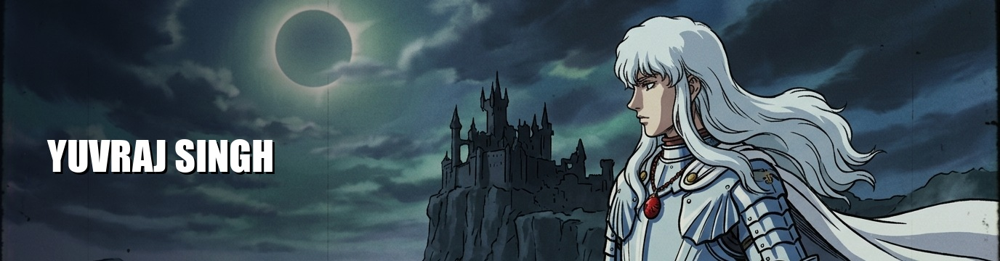

<div align="center">

<a href="http://www.yuvilee.xyz/">
  
</a>

<!-- Dynamic Animated Typing Header -->
<a href="https://github.com/YUVRAJ-SINGH-3178">
  
</a>

<br/>

<!-- Status Badges -->
<p align="center">
  <a href="http://www.yuvilee.xyz/">
    
  </a>
  &nbsp;
  <a href="https://github.com/marketplace/actions/etio-ci-failure-auto-doctor">
    
  </a>
  &nbsp;
  <a href="mailto:satishyuvraj.singh3178@gmail.com">
    
  </a>
  &nbsp;
  <a href="https://github.com/Singularity-Student-Lab">
    
  </a>
  &nbsp;
  <a href="https://github.com/YUVRAJ-SINGH-3178">
    
  </a>
  &nbsp;
  <a href="https://github.com/YUVRAJ-SINGH-3178?tab=followers">
    
  </a>
</p>

</div>

---

### `> whoami`

```yaml
identity:
  name: Yuvraj Singh
  role: DevSecOps Engineer & Full-Stack Tooling Architect
  focus: CI/CD Hardening, Cloud Infrastructure, Automated Diagnostics
  portfolio: http://www.yuvilee.xyz/
  affiliation: Singularity Student Lab (@Singularity-Student-Lab)
  location: India 🇮🇳
  status: Actively shipping open-source tools & cloud infrastructure
```

- 🚀 **Marketplace Author**: Shipped [Etio CI Failure Auto-Doctor](https://github.com/marketplace/actions/etio-ci-failure-auto-doctor) (`v0.1.1`) to the **GitHub Marketplace**: automated diagnosis of failed CI jobs with zero secret leaks.
- 🐍 **Developer Tooling**: Built [Errly](https://github.com/YUVRAJ-SINGH-3178/Errly) (`v0.2.1`), an AI-powered terminal CLI that intercepts and explains Python & Node.js crashes in plain English.
- 🛡️ **DevSecOps & Cloud**: Orchestrating secure, resilient environments across **Docker**, **Kubernetes**, **AWS**, **Terraform**, and automated security scanning pipelines.
- 🔬 **High-Assurance Systems**: Engineering [ULPF](https://github.com/YUVRAJ-SINGH-3178/ULPF) (Universal Log Pre-processing Framework) for SIEM telemetry and [PoF](https://github.com/YUVRAJ-SINGH-3178/PoF) for biometric verification.
- 💼 **Open to Work**: Seeking SRE, DevSecOps, Cloud Engineering, and Full-Stack roles.


---

## ⚡ Tech Stack & Tooling

<table width="100%">
<tr>
<td width="50%" valign="top">

### ☁️ Cloud & DevSecOps
<a href="https://skillicons.dev">
  
</a>

</td>
<td width="50%" valign="top">

### 💻 Programming Languages
<a href="https://skillicons.dev">
  
</a>

</td>
</tr>
<tr>
<td width="50%" valign="top">

### 🌐 Frontend & Mobile
<a href="https://skillicons.dev">
  
</a>

</td>
<td width="50%" valign="top">

### ⚙️ Backend & Databases
<a href="https://skillicons.dev">
  
</a>

</td>
</tr>
</table>

---

## 🚀 Featured Projects

<table>
<tr>
<td width="50%" valign="top">

### 🩺 [Etio CI Failure Auto-Doctor](https://github.com/YUVRAJ-SINGH-3178/Etio)
<a href="https://github.com/marketplace/actions/etio-ci-failure-auto-doctor">
  
</a>
<br/>

[](https://github.com/YUVRAJ-SINGH-3178/Etio/releases)
[](https://github.com/YUVRAJ-SINGH-3178/Etio/blob/main/LICENSE)
[](https://python.org)
[](https://groq.com)
[](https://github.com/YUVRAJ-SINGH-3178/Etio)

**AI-assisted diagnostic action for failing GitHub CI pipelines.** Runs directly inside the target repository workflow, pulls failure logs without exposing workflow tokens, correlates crashes with recent commit diffs, runs bounded bisection, and requests redacted root-cause diagnosis from Groq.

```yaml
# Drop into any workflow:
- name: 🩺 Run Etio Auto-Doctor
  uses: YUVRAJ-SINGH-3178/Etio@v0.1.1
  if: failure()
  with:
    github-token: ${{ secrets.GITHUB_TOKEN }}
    groq-api-key: ${{ secrets.GROQ_API_KEY }}
```

**Key Features:**
- 🛡️ Zero token or secret leakage (scrubs credentials before inference)
- ⚡ In-repo execution with immediate PR/summary feedback
- 🔬 Real workflow bisection via bounded `workflow_dispatch`

</td>
<td width="50%" valign="top">

### 🐍 [Errly: Terminal Crash Explainer](https://github.com/YUVRAJ-SINGH-3178/Errly)

[](https://github.com/YUVRAJ-SINGH-3178/Errly/releases)
[](https://github.com/YUVRAJ-SINGH-3178/Errly)
[](https://github.com/YUVRAJ-SINGH-3178/Errly)

**AI-powered CLI that turns terminal stack traces into plain English.** Wraps Python and Node.js execution, catches crashes, and outputs clear, actionable remediation steps powered by the Groq API.

```bash
# Wrap scripts directly with Errly:
errly run python app.py
errly run node server.js
```

**Key Features:**
- 🌐 Multi-runtime: `.py`, `.js`, `.mjs`, `.cjs`
- 🔒 Client-side secret redaction before network egress
- ⚡ Local TTL-based caching to prevent redundant API queries
- 🛡️ Offline-safe: gracefully shows original error if API is unreachable

</td>
</tr>
<tr>
<td width="50%" valign="top">

### 🛡️ [ULPF: Universal Log Pre-processing Framework](https://github.com/YUVRAJ-SINGH-3178/ULPF)

[](https://github.com/YUVRAJ-SINGH-3178/ULPF)
[](https://github.com/YUVRAJ-SINGH-3178/ULPF)

A high-assurance telemetry preprocessing and normalization pipeline engineered for strategic defense, perimeter nodes, and enterprise SIEM / Data Lake ingestion sinks.

</td>
<td width="50%" valign="top">

### 🔐 [PoF: Proof of Footprint](https://github.com/YUVRAJ-SINGH-3178/PoF)

[](https://github.com/YUVRAJ-SINGH-3178/PoF)
[](https://github.com/YUVRAJ-SINGH-3178/PoF)

End-to-end identity verification pipeline: discovers candidate social profiles via reverse-image search, verifies biometric embedding distance, and anchors immutable cryptographic records onto IPFS and public blockchain testnets.

</td>
</tr>
</table>

---

## 📊 Dynamic GitHub Analytics

<div align="center">

<p align="center">
  
  &nbsp;&nbsp;
  
</p>

<p align="center">
  
</p>

<br/>

| 🏅 Total Contributions | 📦 Public Repositories | 🚀 Published Actions | 📅 Active Member Since |
|:---:|:---:|:---:|:---:|
| **500+** | **30** | **GitHub Marketplace Author** | **Jul 2025** |

</div>

---

## 🏆 GitHub Achievements

<div align="center">

<table align="center">
<tr>
<td align="center" width="160px">
  <a href="https://github.com/YUVRAJ-SINGH-3178?tab=achievements">
    
  </a>
  <br/>
  <b>Pull Shark</b>
  <br/>
  <sub>Bronze • Merged PRs</sub>
</td>
<td align="center" width="160px">
  <a href="https://github.com/YUVRAJ-SINGH-3178?tab=achievements">
    
  </a>
  <br/>
  <b>YOLO</b>
  <br/>
  <sub>Merged PR Without Review</sub>
</td>
</tr>
</table>

</div>

---

## 🤝 Let's Connect & Collaborate

<div align="center">

<p align="center">
  <a href="http://www.yuvilee.xyz/">
    
  </a>
  &nbsp;
  <a href="https://www.linkedin.com/in/yuvraj-singh-3178saturn">
    
  </a>
  &nbsp;
  <a href="https://github.com/YUVRAJ-SINGH-3178">
    
  </a>
  &nbsp;
  <a href="mailto:satishyuvraj.singh3178@gmail.com">
    
  </a>
  &nbsp;
  <a href="https://instagram.com/ig_yuvie">
    
  </a>
</p>

</div>
